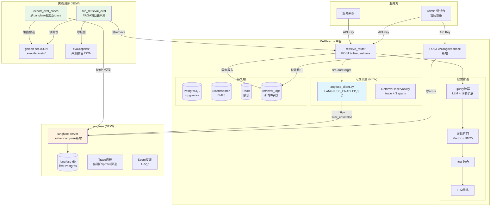
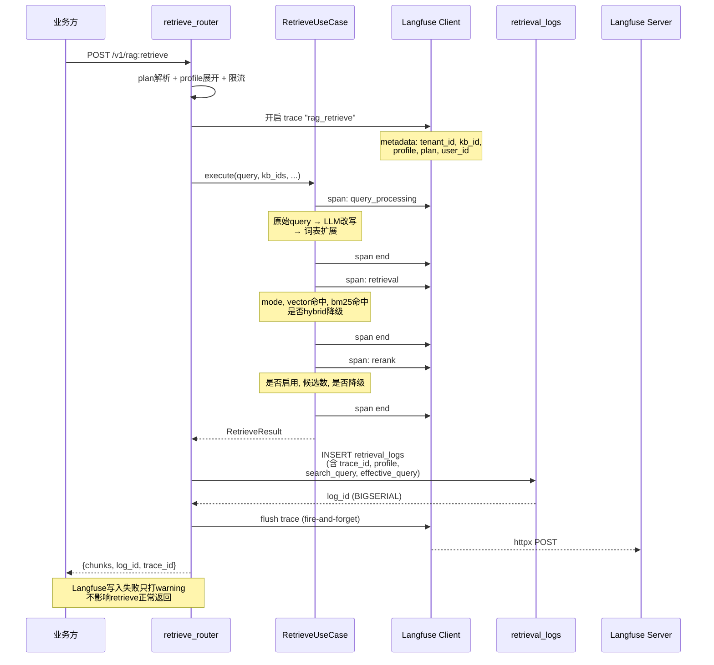
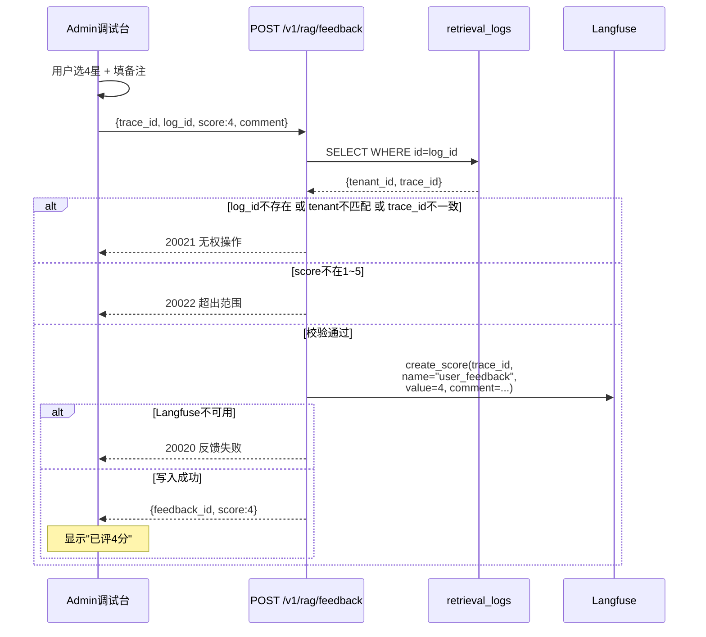
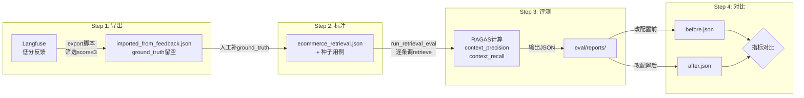

# 检索效果调优系统 — 第一性原理设计

> 基于三篇飞书文档 + 现有 RAGNexus 架构，从第一性原理推导设计

---

## 一、第一性原理分析

### 1.1 当前系统的根本缺陷

现有 RAGNexus 检索链路是一个**黑盒**：

```
Request → profile展开 → 限流 → 检索管道 → 返回chunks
                                    ↓
                            仅写 retrieval_logs（8字段，无过程信息）
```

**缺失的三件事**：
| 能力 | 现状 | 后果 |
|---|---|---|
| **可观测** | 只记录最终结果，不记录中间过程 | bad case 无法复盘 |
| **可反馈** | 无反馈入口 | 线上问题沉淀不下来 |
| **可测评** | 无测评体系 | 调参靠感觉，不敢发版 |

### 1.2 第一性原理推导

**原理1：每一次检索都必须留下完整现场**
→ 检索的全过程（改写→召回→融合→重排）必须结构化记录，不依赖日志grep
→ 但不能阻塞主请求（Langfuse 旁路写入，fire-and-forget）

**原理2：反馈必须锚定到具体检索**
→ trace_id 是 Langfuse 生成的 UUID，log_id 是我们自己DB的主键
→ 两条链：Langfuse 链（给研发看详情）+ 本地DB链（给业务方关联流水）
→ 即使 Langfuse 挂了，本地 log_id 仍然可用

**原理3：测评必须可复现**
→ 同一批 question + 同一配置 = 可比较的数值
→ ground_truth 是锚点，retrieve 每次都重跑
→ 测例从线上反馈来（低分case → 补ground_truth → 入测评集），越用越贴近真实

**原理4：工具是辅助，中台核心能力不变**
→ retrieve 接口契约不变
→ Langfuse 离线不影响检索
→ RAGAS 离线不影响线上

---

## 二、系统架构全景图



---

## 三、检索链路的 Trace 结构



---

## 四、反馈链路



---

## 五、离线测评链路



---

## 六、模块分解

### 6.1 新增文件清单

| 文件 | 类型 | 说明 |
|---|---|---|
| `src/ragnexus/observability/langfuse_client.py` | NEW | Langfuse 封装，含 `RetrieveObservability` |
| `src/ragnexus/observability/__init__.py` | NEW | 模块入口 |
| `src/ragnexus/schemas/feedback.py` | NEW | FeedbackRequest, FeedbackData |
| `src/ragnexus/services/feedback_service.py` | NEW | 反馈业务逻辑 |
| `src/ragnexus/adapters/http/feedback_router.py` | NEW | POST /v1/rag/feedback 路由 |
| `scripts/export_eval_cases_from_langfuse.py` | NEW | 从 Langfuse 导出低分 case |
| `scripts/run_retrieval_eval.py` | NEW | RAGAS 批量评测 |
| `eval/datasets/_seed_ecommerce.json` | NEW | 冷启动种子（可选5-10条） |

### 6.2 修改文件清单

| 文件 | 改动 |
|---|---|
| `docker-compose.yml` | 新增 langfuse + langfuse-db 两个 service |
| `config.py` | 新增 4 个 LANGFUSE_* 配置项 |
| `.env` / `.env.example` | 新增 LANGFUSE_* 变量 |
| `pyproject.toml` | 新增 langfuse 依赖 + eval optional-dependencies |
| `core/errors.py` | 新增 20020/20021/20022 错误码 |
| `composition.py` | 注入 langfuse_client, feedback_service, feedback_router |
| `retrieve_router.py` | 响应加 log_id + trace_id；检索前后包裹 trace |
| `retrieve_use_case.py` | 集成 RetrieveObservability，三个子 span |
| `adapters/retrieve_log/pg.py` | 新增 4 字段写入 |
| `docs/sql/schema.sql` | retrieval_logs 加 4 列（或 Alembic migration） |
| `frontend/src/types/api.ts` | 加 log_id, trace_id, FeedbackRequest, FeedbackData |
| `frontend/.../RetrievePage` | 加反馈条（五星+备注+提交） |
| `admin/src/utils/ragService.ts` | 加 submitFeedback() |
| `.gitignore` | 加 eval/reports/ |
| `docs/tenant-onboarding.md` | 加检索反馈小节 |

### 6.3 关键设计决策（与现有架构对齐）

| 决策 | 理由 |
|---|---|
| **Langfuse client 用 httpx(trust_env=False)** | 避免本地代理干扰 localhost:3000，与现有 ES 一致 |
| **trace 作为 fire-and-forget 旁路** | 不增加检索延迟，写入失败只打 warning |
| **feedback 不建本地表** | Langfuse 是反馈数据的唯一真相源，避免双写同步 |
| **log_id 用 BIGSERIAL** | 已存在，直接复用 retrieval_logs.id |
| **eval 脚本独立运行** | 不嵌 FastAPI，不建新表，不污染线上 |
| **LANGFUSE_ENABLED 开关** | false 时所有 helper 静默，不创建 trace |
| **trace_id 响应返回，log_id 响应返回** | 两条链独立，业务方可以只用 log_id |
| **metadata 不塞全文** | 只存 chunk_id + score 摘要，避免 Langfuse 面板体积爆炸 |

---

## 七、错误码新增

| code | HTTP | 含义 | 触发场景 |
|---|---|---|---|
| 20020 | 503 | 反馈服务不可用 | LANGFUSE_ENABLED=false 或写入异常 |
| 20021 | 403 | 无权操作该反馈 | log_id/trace_id 不匹配或跨租户 |
| 20022 | 422 | score 超出范围 | score < 1 或 > 5 |

## 八、与现有套餐系统的关系

- **无新增 plan 限制**：可观测和反馈是基础设施能力，不消耗配额
- trace metadata 携带 `tenant_id`、`plan`、`profile`，方便在 Langfuse 面板按套餐筛选
- eval 脚本通过 API Key 鉴权（与普通业务方一致），受现有限流约束

---

## 九、待讨论的关键问题

1. **Langfuse 的 docker-compose 集成方式**：是直接在现有 docker-compose.yml 中加两个 service，还是单独 compose 文件？
   - 推荐：直接加到现有 compose，`docker compose up -d langfuse` 按需启动

2. **Alembic migration vs 直接改 schema.sql**：目前项目用 init-db 容器执行 schema.sql 初始化
   - 推荐：新增 Alembic migration `0006_retrieval_log_observability`（文档要求），同时更新 schema.sql 保持同步

3. **前端反馈条的位置**：文档描述在"检索与召回"Card 内、chunk 列表上方
   - 确认：是否复用现有 Admin 调试台的 RetrievePage 组件？

4. **eval 脚本的 API 地址**：脚本通过 HTTP 调 retrieve，需要知道服务地址
   - 默认 `http://127.0.0.1:8000`，通过 `--base-url` 覆盖

5. **langfuse-db 的数据持久化**：需要加 volume 吗？
   - 推荐加 volume，避免容器重建后丢失历史 trace

6. **trace 的采样策略**：是否所有检索都写 trace？高并发时会不会成为瓶颈？
   - 文档未提采样，先全量写入。Langfuse 本身设计支持高吞吐，且写入失败不影响主链路
