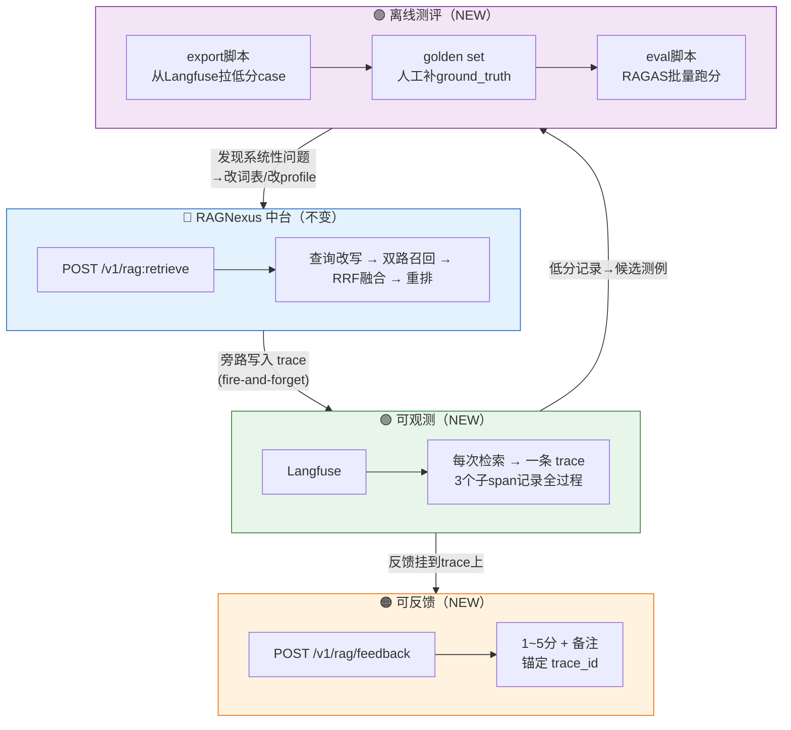
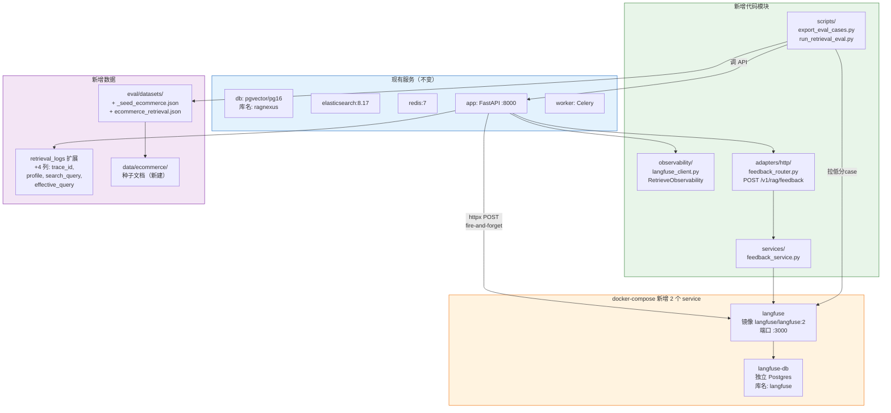
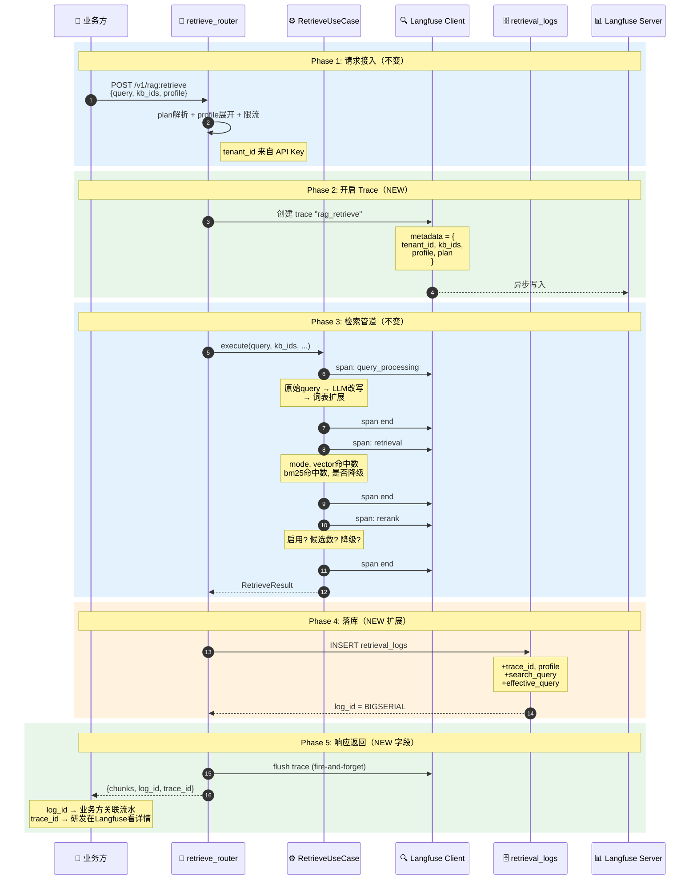
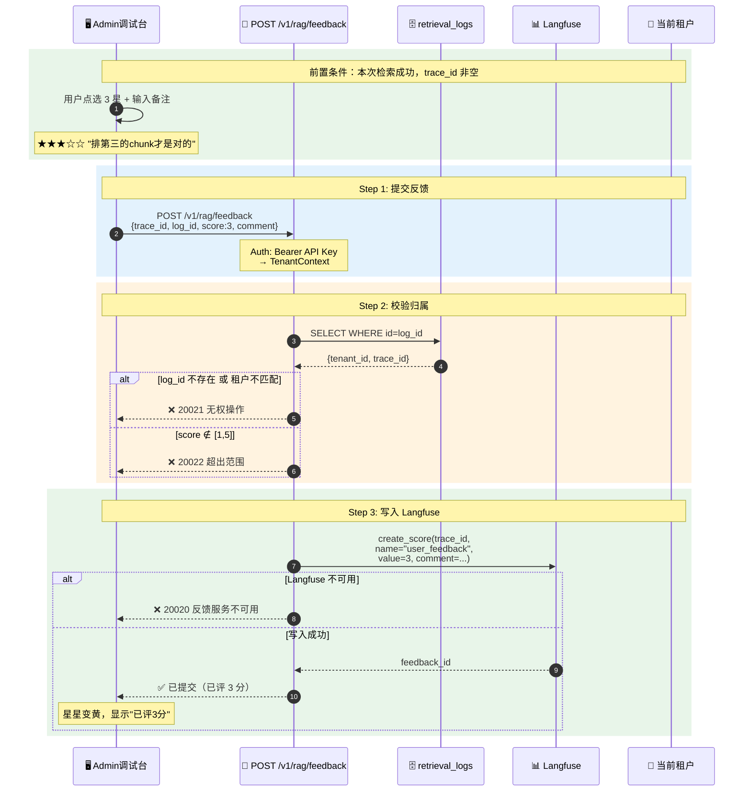
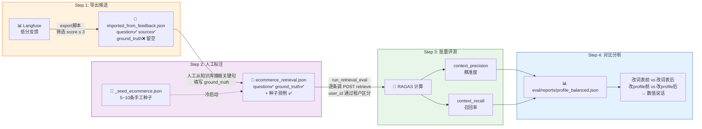
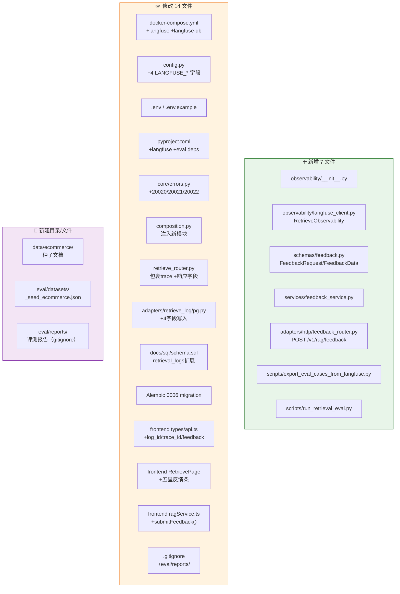

# 检索效果调优 — 需求全景图解

> 三篇飞书文档需求 + 现有 RAGNexus 架构，从第一性原理出发

---

## 一、三角闭环全景

> **闭环逻辑**：可观测记录现场 → 反馈收集评分 → 离线测评量化效果 → 改配置 → 再测 → 上线 → 再看可观测数据

---

## 二、新增组件与现有架构的关系

---

## 三、一次检索的完整生命周期（核心链路）

---

## 四、Trace 内部结构

```mermaid
graph TB
    Trace["🔷 trace: rag_retrieve"]
    
    Meta["📋 metadata"]
    Meta --> M1["tenant_id: 'my_tenant'"]
    Meta --> M2["kb_ids: ['939a5baf-...']"]
    Meta --> M3["profile: 'balanced'"]
    Meta --> M4["plan: 'standard'"]

    S1["📗 span: query_processing"]
    S1 --> S1i["input: {raw_query}"]
    S1 --> S1o["output: {effective_query, synonym_applied}"]

    S2["📘 span: retrieval"]
    S2 --> S2i["input: {mode, search_query}"]
    S2 --> S2o["output: {vector_count, bm25_count, fused_count, degraded}"]

    S3["📙 span: rerank"]
    S3 --> S3i["input: {enabled, candidates}"]
    S3 --> S3o["output: {reranked_count, degraded}"]

    TO["📤 trace output"]
    TO --> TO1["[{chunk_id, score}, ...]"]
    Note1["⚠️ 不塞全文，只存摘要<br/>避免面板体积爆炸"]

    Trace --> Meta
    Trace --> S1
    Trace --> S2
    Trace --> S3
    Trace --> TO
    S1 -.-> Note1
    S2 -.-> Note1
    S3 -.-> Note1

    style Trace fill:#bbdefb,stroke:#1565c0,stroke-width:3px
    style Meta fill:#e3f2fd,stroke:#1565c0
    style S1 fill:#c8e6c9,stroke:#2e7d32
    style S2 fill:#c8e6c9,stroke:#2e7d32
    style S3 fill:#c8e6c9,stroke:#2e7d32
    style TO fill:#fff9c4,stroke:#f9a825
    style Note1 fill:#ffcdd2,stroke:#c62828
```

---

## 五、反馈链路

---

## 六、离线测评流水线

---

## 七、文件变更全景

---

## 八、错误码总览（现有 + 新增）

| code | HTTP | 含义 | 来源 |
|---|---|---|---|
| 20005 | 429 | API 限流 | 现有 |
| 20013 | 403 | 套餐不支持 | 现有 |
| 20014 | 429 | 配额超限 | 现有 |
| **20020** | 503 | 反馈服务不可用 | **NEW** |
| **20021** | 403 | 无权操作该反馈 | **NEW** |
| **20022** | 422 | 评分超出范围 | **NEW** |

---

## 九、关键边界（不做什么）

| 不做 | 原因 |
|---|---|
| 不建 feedbacks 表 | Langfuse 是反馈唯一真相源 |
| 不做历史查询 API | 查历史直接用 Langfuse UI |
| 不做 Langfuse 统计大盘 | 非本文范围 |
| 不做 RAGAS 前端页面 | 脚本独立运行 |
| faithfulness / answer_relevancy | rag-center 只返回 chunk，不生成答案 |
| 不替换 retrieve 接口 | Langfuse 是旁路，契约不变 |
| 不接入 LangSmith | 云端托管，数据安全风险 |

---

## 十、验收标准速查

| # | 标准 | 验收方式 |
|---|---|---|
| 1 | LANGFUSE_ENABLED=true → log_id + trace_id 非空 | curl retrieve |
| 2 | Langfuse UI 可见 trace + 3个span + metadata | 浏览器打开 :3000 |
| 3 | LANGFUSE_ENABLED=false → trace_id=null, log_id 正常 | curl retrieve |
| 4 | retrieval_logs 4新字段有值，id=log_id | 查 DB |
| 5 | 调试台 4星+备注 → Langfuse Scores=4 | Admin UI → Langfuse UI |
| 6 | curl feedback score=2 → Langfuse user_feedback=2 | curl + Langfuse UI |
| 7 | 错误 log_id → 20021 | curl |
| 8 | score=0/6 → 20022 | curl |
| 9 | LANGFUSE_ENABLED=false → feedback 20020 | curl |
| 10 | 再次检索 → 反馈条清空 | Admin UI |
| 11 | export 拉出 score≤3 的 case，ground_truth 空 | 跑脚本 |
| 12 | 补 ground_truth 后 eval 输出 2 项指标 | 跑脚本 |
| 13 | ground_truth 空的 case 自动 skip | 终端输出 |
| 14 | 改配置前后指标可对比 | diff 两份报告 |
| 15 | 缺 key/DB 挂/Langfuse 挂 → 友好报错不崩溃 | 故障注入 |
